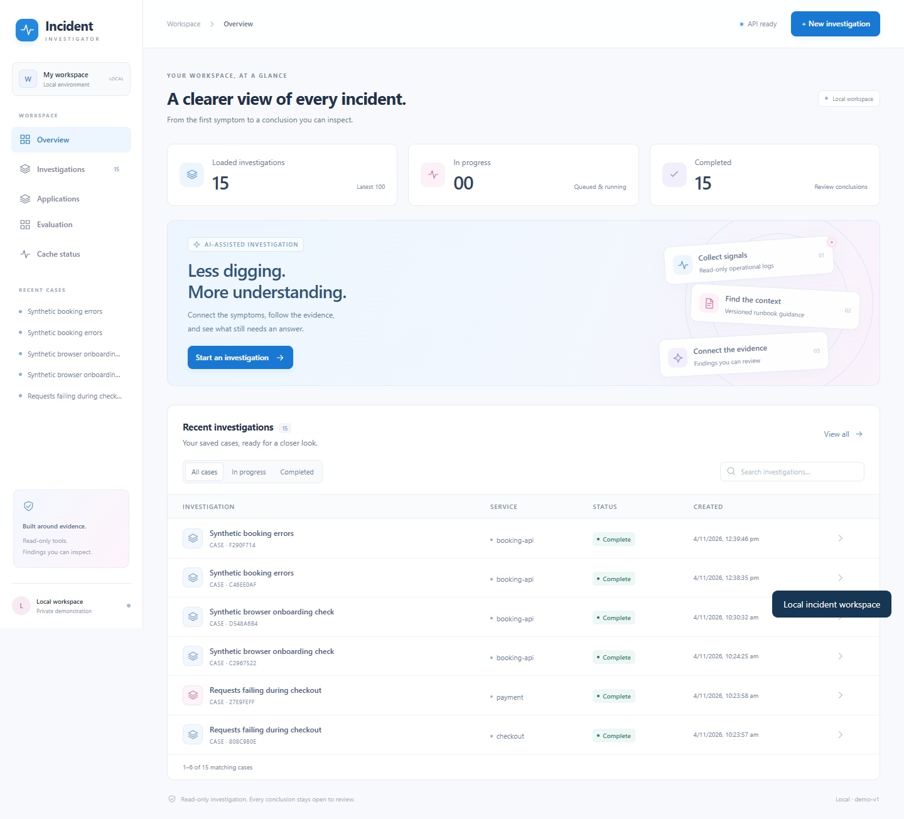

# AI Incident Investigator

AI Incident Investigator helps a developer investigate service failures by gathering scoped logs, retrieving versioned runbooks and, when explicitly enabled, using a bounded AI agent to propose evidence-linked hypotheses and follow-up checks. PostgreSQL stores incidents, durable jobs, observations and reports; optional Redis avoids repeated retrieval work, and optional private S3 stores report exports.

> **Local-only and unauthenticated. Do not expose the API, dashboard or demo controls to a network.** Keep the supplied loopback bindings. This is a local portfolio application, not an AWS-hosted service. Only the optional S3 integration uses real AWS storage; it is disabled in the quickstart. The security review was an author/AI-assisted self-review, not an independent audit. Original incident text and live/legacy evidence may remain in local database records and exports despite outbound model redaction. Never publish your runtime data or assume an export is sanitized.

Inspired by [Aurora](https://github.com/Arvo-AI/aurora) and [HolmesGPT](https://github.com/HolmesGPT/holmesgpt). This is an independently developed focused application, not a fork. These projects are architectural references; their capabilities are not claims about this implementation.



[Saved-workspace walkthrough](docs/assets/demo.webm): a previously saved report and operator views, without a new model request.

## Features

- Versioned application/service registration, bounded captured-log onboarding and Markdown runbook publication.
- Atomic incident/job admission, idempotency keys, leased workers, fenced state writes, cancellation and replayable persisted progress.
- Application/release-scoped PostgreSQL full-text plus exact pgvector retrieval, reciprocal rank fusion and immutable passage references.
- A bounded LangGraph workflow with typed read-only tools, explicit budgets and report-reference validation; Gemini access is opt-in.
- Optional Redis embedding/retrieval caches, default off, with API-process cache diagnostics and database fallback.
- Normalized and native Alertmanager admission with a separately configured shared token; selected read-only tools exposed over local stdio MCP.
- Local or private-S3 report exports with leased delivery, SHA-256 verification, reconciliation and short-lived download links.
- React dashboard, a small shopping-service demo, frozen evaluation artifacts and documented negative results.

## Stack

Python / FastAPI / Pydantic / SQLAlchemy / Alembic; PostgreSQL + pgvector; FastEmbed with pinned CPU MiniLM artifacts; LangGraph and a native Gemini adapter; Redis; boto3 / S3; React / TypeScript / Vite; Docker Compose; pytest / Playwright / Ruff / Prettier. Full metrics/traces/deployment connectors, Kubernetes and automatic remediation are outside the implemented scope.

## Quickstart

Prerequisites: Docker with a running Linux engine and Compose v2+, Python 3.12 or 3.13, and Node.js 22.12+ with npm for the dashboard. Commands below use PowerShell from the repository root. Use a new local checkout; do not copy someone else's `.env` or Docker volumes.

```powershell
python scripts/init_local_env.py
docker compose --profile fixture up --build -d --wait
powershell -ExecutionPolicy Bypass -File scripts/create-sample-incident.ps1 -BaseUrl http://127.0.0.1:8001
```

The initializer generates a random local database password without printing it and never overwrites an existing `.env`. Compose constructs `DATABASE_URL` explicitly and runs `alembic upgrade head` in the `migrate` service before API/worker startup. The quickstart needs no Gemini or AWS credentials and uses clearly marked fictional log evidence, not a live target incident. Open [API documentation](http://127.0.0.1:8001/docs). To check migrations and readiness:

```powershell
docker compose logs migrate
Invoke-RestMethod http://127.0.0.1:8001/readyz
```

Start the dashboard in another terminal:

```powershell
npm --prefix frontend ci
npm --prefix frontend run dev
```

Open [the dashboard](http://127.0.0.1:5173). Its development proxy targets API port 8001. If API_PORT is changed, adjust the local Vite proxy as well; API port overrides alone do not reconfigure the dashboard. Stop a stack with `docker compose stop`; keep volumes when preserving evidence. There is no instruction here to delete volumes or runtime data.

### Optional RAG and AI

Prepare the checksum-locked embedding artifacts into this checkout's ignored data directory, then enable retrieval. The first command starts only the already configured worker dependencies; it does not invoke a model:

```powershell
docker compose --profile fixture run --rm -v "${PWD}/data:/app/data" worker python scripts/prepare_embeddings.py
docker compose -f compose.yaml -f compose.knowledge.yaml --profile fixture up --build -d --wait
```

For the three-service live shopping demo instead of fixtures, use `scripts/start-stack.ps1 -LiveDemo -Knowledge`. That command also publishes demo checkout/controller on loopback ports 8002/8003. Do not start it over another running demo using those ports. Downloads require network access; embedding at runtime uses the prepared local files.

Hosted reasoning is separately opt-in: configure `GEMINI_API_KEY`, `GEMINI_MODEL`, `GEMINI_FREE_TIER_CONFIRMED=1` and `AGENT_MODE=gemini` in your private local configuration, then use `scripts/start-stack.ps1 -LiveDemo -Knowledge -Agent`. Verify current provider access/quota yourself; no billing tier or spending guarantee is implied. Tests do not need a provider key. See [agent setup](docs/AGENT.md), [application onboarding](docs/APPLICATIONS.md) and [S3 setup](docs/S3_CONNECTION.md). The ordinary startup never provisions AWS resources.

## Run tests and checks

The verification image installs all optional SDKs and runs against separate test schemas/database and disposable Redis. Its runtime has no provider/AWS credentials. From the root after generating local configuration:

```powershell
docker compose -p investigator-checks -f compose.yaml -f compose.knowledge.yaml -f compose.cache.yaml -f compose.verify.yaml --profile verification run --build --rm verify
```

This runs `tests` plus the workflow-grader checks, including PostgreSQL/Redis and actual local MCP SDK/stdio checks. Evaluation data is mounted read-only into this operator test container, never into the runtime agent image. No embedding weights, hosted model or S3 account are needed for these checks. The test runner creates `investigator_test` and removes only its own temporary test schemas/keys; it does not test against an existing application's state. Existing checks intentionally test interrupted writes, replay, conflicting admission and unavailable dependencies.

For host Python checks, first create a virtual environment and install locked dependencies:

```powershell
python -m venv .venv
.venv/Scripts/python.exe -m pip install -r requirements-agent.lock -r requirements-cache.lock -r requirements-mcp.lock -r requirements-artifacts.lock
.venv/Scripts/python.exe -m pytest -q tests evaluation/diagnosis-v2/test_scoring.py
.venv/Scripts/python.exe -m ruff check backend demo-app tests scripts evaluation/run.py evaluation/build_dataset.py evaluation/answers.py evaluation/diagnosis-v2
.venv/Scripts/python.exe -m ruff format --check backend demo-app tests scripts evaluation/run.py evaluation/build_dataset.py evaluation/answers.py evaluation/diagnosis-v2
.venv/Scripts/python.exe scripts/verify_documented_metrics.py
```

Without explicit `TEST_POSTGRES_URL` and `TEST_REDIS_URL`, host tests skip the corresponding external-service checks. Use the Docker command for the complete integration run. Host application processes require an explicit `DATABASE_URL`; imports do not connect to a database. Start a host API with `python -m uvicorn investigator.api:create_app --factory --host 127.0.0.1 --port 8001` after setting `PYTHONPATH=backend` and the intended private database URL.

```powershell
npm --prefix frontend run build
npm --prefix frontend run format:check
npm --prefix frontend exec -- playwright install chromium
$env:CI = '1'
npm --prefix frontend test
```

Playwright starts a fresh loopback-bound Vite server. If port 5173 is already used, set `TEST_DASHBOARD_PORT` to an unused local port before testing. An already installed compatible Edge can be selected with `BROWSER_CHANNEL=msedge`; Chromium is the default. Browser tests use controlled API responses and do not prove real-model behavior.

## Configuration

`.env.example` documents placeholders only. Keep secrets in private environment configuration. Compose injects only the explicitly listed variables into each service; the worker receives no S3 credentials.

| Variable | Purpose / safe default |
|---|---|
| POSTGRES_USER / POSTGRES_DB | Local database identity; initializer supplies local values |
| POSTGRES_PASSWORD | Generated by `scripts/init_local_env.py`; no runtime password fallback |
| DATABASE_URL | Required for host database processes; explicitly constructed inside Compose |
| API_PORT | Loopback API port, default 8001 |
| EVIDENCE_BASE_URL | Operator-owned fixed evidence source; incident inputs cannot set URLs |
| AGENT_MODE | `disabled` by default; `gemini` requires explicit provider configuration |
| GEMINI_API_KEY / GEMINI_MODEL | Private provider credential / selected supported model |
| GEMINI_FREE_TIER_CONFIRMED | Explicit operator acknowledgement; default 0 |
| KNOWLEDGE_ENABLED / KNOWLEDGE_MODEL_DIR | Set by the retrieval override; local prepared model directory |
| CACHE_ENABLED / CACHE_URL / CACHE_NAMESPACE | Cache off by default; opt into isolated local Redis with `-Cache` |
| ALERT_WEBHOOK_TOKEN | Blank disables both alert ingress endpoints; configured token must be at least 32 characters |
| ARTIFACT_BACKEND | `disabled`, `local` or `s3`; archives require explicit selection |
| ARTIFACT_SPOOL_DIR / ARTIFACT_LOCAL_DIR | Operator-owned directories, supplied by archive Compose override |
| ARTIFACT_S3_BUCKET / AWS_REGION | Private bucket / region chosen by the operator; no real values in source |
| ARTIFACT_S3_PRIVATE_CONFIRMED | Required S3 acknowledgement after private-bucket checks |
| AWS_ACCESS_KEY_ID / AWS_SECRET_ACCESS_KEY / AWS_SESSION_TOKEN | Temporary scoped API/uploader credentials only; never send them to the model worker |
| MCP_API_BASE_URL | Fixed local investigator API for the optional stdio adapter |
| TEST_POSTGRES_URL / TEST_REDIS_URL | Explicit disposable integration-test services |
| TEST_DASHBOARD_PORT / BROWSER_CHANNEL | Optional browser-test port/browser overrides |

## Design guarantees and limits

- Jobs have **at-least-once execution, not exactly-once execution**. Reads can repeat after interruption; durable admission and fenced state updates prevent stale attempts from advancing owned state.
- A model request with an unknown outcome stops rather than automatically retrying. The system does not hide an unknown provider charge or regenerate a successful replacement result.
- Report/reference checks do not prove semantic faithfulness or correct root-cause identification. Evidence and hypotheses remain distinguishable; unsupported conclusions can still pass structural checks.
- PostgreSQL FTS uses `plainto_tsquery` / `ts_rank_cd`; it is **not BM25**. Vector search is exact over the small corpus, with RRF combining candidates.
- Cache is **optional and off by default**. It is not a queue, authority or readiness dependency. Hits help repeated queries; unique queries can become slower.
- Database state and object storage are separate transactions. Leased exports reconcile an object written before database finalization; integrity checking does not sanitize its contents.

## Measured results

Historical measurements and failures are preserved, not rerun to improve resume claims. [Evaluation and reproduction](docs/evaluation.md) links every result to its source artifact. The local retrieval-only cache experiment measured warm p50 **9.245 to 1.694 ms**, while unique-query p50 increased **9.781 to 12.466 ms**. These are sequential local retrieval measurements, not whole-investigation speed or model quality. The experimental ranking was not promoted; the reserved workflow comparison remains incomplete.

[Local release verification and resolved failures](docs/RELEASE_VERIFICATION.md) records what was actually checked, including remaining scanner alerts.

## Known limitations

The application is unauthenticated and has no tenant isolation. Containers currently use their default user; separate least-privilege runtime/migration database roles are not implemented. These limitations are retained explicitly instead of claiming an unverified hardening change. Per-investigation budgets do not provide an operator-wide submission quota. Redaction is pattern based and cannot find every secret, encoding or personal datum. Local database records and exports may retain original incident/live evidence. Full provider comparison, independent usefulness review, clean-machine setup and remote CI remain unestablished. The revised S3 credential watcher has unit coverage and an initial session check, but a sustained timed renewal of that revised watcher remains unobserved. No public hosting is configured.

## Project structure and documentation

```text
backend/investigator/   API, jobs, agent, retrieval, snapshots and archives
backend/migrations/     PostgreSQL schema migrations
demo-app/               Shopping services and isolated fault controls
frontend/               React dashboard and browser tests
knowledge/              Reviewed runbooks and pinned model metadata
examples/               Sanitized authored fixtures and attributed external excerpt
evaluation/             Frozen questions, captures, protocols and results
scripts/                Operator setup, verification and benchmark commands
infra/                  Dockerfile and parameterized IAM policy template
docs/                   Architecture, decisions, evaluations and operating guides
```

[Architecture](docs/ARCHITECTURE.md) · [Decisions](docs/DECISIONS.md) · [Evaluation](docs/evaluation.md) · [Security boundaries](docs/SECURITY.md) · [Current status](docs/STATUS.md) · [Runbooks](docs/RUNBOOK_UPLOADS.md) · [Caching](docs/CACHE.md) · [Archives](docs/ARTIFACTS.md) · [Alerts](docs/ALERTS.md) · [MCP](docs/MCP.md).

The existing uppercase architecture/decision filenames are retained for case-sensitive link compatibility. Older planning/status sections are historical and must not be read as a current feature inventory; the architecture and README describe the release scope. Original code is [MIT licensed](LICENSE). See [third-party notices](THIRD_PARTY_NOTICES) and the adjacent [RCAEval license](examples/external-online-boutique/LICENSE-RCAEval.txt).
