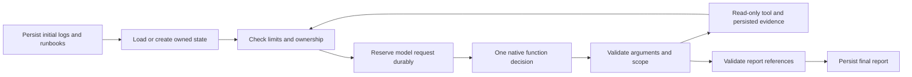

> Release-source note (5 November 2026): current report workflow remains bounded-investigator-v5; redaction is model-boundary-v3. Older versions/results below remain historical. Follow the root README for current setup.

# Bounded model-backed investigation

## What runs now

Application/capture update: the current workflow is bounded-investigator-v4. Tool service IDs and permissions now come from a pinned registered application configuration, rather than a fixed three-service enum. Snapshots are queried by the same bounded loop through a read-only adapter; missing coverage never falls back to shopping logs. Native requests carry the validated topology and model-boundary-v2 redaction. The captured workflow was checked in evidence-only mode and with a scripted provider, not rerun as an actual-model diagnosis benchmark. See APPLICATIONS.md and SECURITY.md. The actual-model results below describe the preserved earlier shopping smoke.

One LangGraph workflow chooses between three read-only tools and a structured finish action. It starts with the existing logs and runbook evidence, can inspect a permitted downstream service, and produces observations, hypotheses, missing evidence, and suggested checks with references. The selected trial model is gemini-3.5-flash-lite. Keys remain in the ignored local .env and are passed only to the worker, not the API, UI, database rows, or model context.

The first live smoke investigation completed using two actual model calls and 7,950 provider-reported tokens: 7,233 input and 717 output, with zero reported thought tokens. It followed checkout's failed payment dependency, inspected payment logs, and related payment 503 to checkout 502. A cited runbook was also used. This establishes one working path, not general diagnosis accuracy or the cause of payment's unavailability.

The original generated example is preserved in docs/example-agent-investigation.json; qualification metadata is in docs/gemini-qualification.json. The model labeled its hypothesis service as checkout and listed inventory logs as missing evidence. It did not establish why payment returned 503. Preserve these limits rather than presenting the example as a complete root-cause benchmark.

## Configuration and reproduction

The user confirmed that the key's project is on Google's Free tier. No billing upgrade or cloud provisioning was performed. Gemini 3.8 Flash authenticated for metadata but qualification encountered transport failure and provider high-demand responses, including HTTP 503. The lighter free-tier Flash-Lite model passed a native function-call trial, so it was selected explicitly for this increment. There is no automatic model fallback.

From the repository root in PowerShell:

```powershell
.\.venv\Scripts\python.exe -m pip install -r requirements-agent.lock
.\.venv\Scripts\python.exe scripts/prepare_embeddings.py
```

Keep the existing database settings in .env and add GEMINI_API_KEY privately. Check the key's project is Free in AI Studio. After that confirmation:

```powershell
.\.venv\Scripts\python.exe scripts/qualify_gemini.py --confirm-free-tier --model gemini-3.5-flash-lite --output work/gemini-qualification.json
.\.venv\Scripts\python.exe scripts/configure_agent.py --model gemini-3.5-flash-lite --confirm-free-tier
powershell -ExecutionPolicy Bypass -File scripts/start-stack.ps1 -LiveDemo -Knowledge -Agent
.\.venv\Scripts\python.exe scripts/verify_agent_demo.py --output work/agent-live-demo.json
```

Qualification performs one explicit generative request; it is not a unit test. The live demonstration performs one bounded investigation. It restores payment before submitting the investigation and never places the fault setting or scenario label into the incident description. Do not run repeated live evaluations merely because an API key exists.

configure_agent.py updates only AGENT_MODE, GEMINI_MODEL, and GEMINI_FREE_TIER_CONFIRMED, preserving the key and database settings. The Free-tier flag records operator confirmation; application code cannot independently certify the account's billing state or quotas. A future paid provider requires a separate explicit configuration decision.

Without -Agent, the launcher selects the evidence/retrieval worker and performs no generative calls. With -Agent, calls still require AGENT_MODE=gemini, a specific model, a key, and the free-tier confirmation flag. Set AGENT_MODE=disabled in .env and restart with the same switches to keep the agent dependencies installed without hosted inference. For the earlier zero-model demo, use verify_live_demo.py after starting without -Agent.

## Workflow and permissions



Available actions are search_logs, search_runbooks, get_service_dependencies, and finish_investigation. Arguments are Pydantic models with extra fields forbidden. A model cannot supply time windows, destinations, SQL, shell commands, or controller actions. Checkout scope includes checkout, inventory, and payment from a reviewed dependency map. Payment and inventory scopes do not gain unrelated service access. The observation window remains the validated incident window.

Each model request is a fresh decision over explicitly supplied state, evidence, and permitted actions. The adapter uses Gemini native function declarations with one permitted function call per response. Application code executes the tool and includes the resulting evidence in the next request. It does not delegate automatic execution to an SDK or replay opaque thought signatures. Private thought text is not requested or persisted. LangSmith tracing is explicitly disabled around graph execution and in the worker environment.

Logs and documents are untrusted inputs. Prompts identify that boundary, while code enforces tool names, argument schemas, service scope, fixed source URLs, result sizes, and citation ownership. This limits authority; it is not proof of universal prompt-injection resistance or semantic correctness.

## Durable state and recovery

Alembic 0003 adds investigation_checkpoints. LangGraph handles control flow; the application saves JSON state through the same transactionally enforced job lease used for evidence. This is application-owned workflow persistence, not LangGraph's native PostgreSQL checkpointer. A generic saver with a separate connection would not automatically inherit the application's stale-owner protection, so it is deliberately not used here.

Checkpoints retain phase, pending action, evidence IDs, completed call keys, limits, prompt hash, workflow/model identity, usage reservations, and available provider usage. Every save refreshes/checks ownership in the same transaction as the state update. An old or cancelled worker cannot advance state or finalize a report. A background heartbeat runs every ten seconds during model-backed processing.

- Reserve a model request before sending it. If a worker disappears before recording the outcome, recovery stops with interrupted_model_outcome_unknown. It keeps the reservation and does not automatically reissue that request.
- Persist a returned decision before executing its action. A reclaimed job can execute the already-saved decision without another model request.
- Persist read-only results under stable call IDs. If evidence committed before the next state update, recovery finds and reuses it. An uncommitted read may run again, with a conservative additional reservation. This is not exactly-once execution.
- Changes to the workflow identity, prompt, provider, or limits stop recovery rather than silently continuing with a different configuration.
- Previous runbook observations remain pinned by their saved evidence and corpus revision. A later explicitly requested runbook search can use the newly active corpus, with its own recorded revision.

## Limits and failure behavior

Defaults are at most eight model request reservations, twelve tool attempts including initial collection, and a 120-second elapsed workflow window. The window includes downtime and is checked before/after calls; it does not forcibly kill an already-running HTTP operation. Requests have bounded transport timeouts and response sizes, with ownership checked again before writes or further actions.

Each model request is capped at 32,000 UTF-8 serialized bytes; cumulative requests at 128,000 bytes. Up to twenty records per log observation are included, preferring errors while retaining original record indices. Stored evidence remains available separately. There is a requested 2,048-token generation cap per call, a 16,384 cumulative output reservation cap, and a 32,768 reported-token stop threshold. Byte counts and reservations are not exact provider tokenization or billing guarantees; provider-reported usage includes thinking tokens when supplied. Already-consumed usage cannot be undone by a later stop.

Repeated identical calls stop the workflow. Invalid arguments, unavailable providers, rate limits, incomplete output, or invalid references produce a partial/inconclusive report rather than invented diagnosis. Provider errors are sanitized; there are no automatic provider retries or paid fallbacks. Application code enforces subsequent-action limits, not account-wide spend caps or the behavior of other clients using the same key.

## Report validation and cancellation

Observations and hypotheses require available, investigation-owned log references and valid record indices. Runbook references must match a passage actually retrieved into that investigation. Guidance cannot stand in for current observational evidence. Unsupported fields such as confidence percentages are rejected by the schema. These checks establish referential integrity, not whether natural-language claims follow semantically from their citations.

POST /api/investigations/{id}/cancel atomically marks queued/running work cancelled and invalidates its ownership. Repeated cancellation is idempotent; cancelling terminal completed/failed work conflicts. An in-flight read or model request may finish and consume quota, but its stale result cannot advance the cancelled investigation. Explicit user retry remains deferred.

## Verification and remaining work

All 88 tests passed in the final Python 3.12 agent container, including twelve PostgreSQL checks. Tests cover tool authority, scope, duplicate calls, model/tool/byte/token/time limits, malformed provider replies, missing usage, cancellation, interrupted requests, persisted tool reuse, checkpoint fencing, and concurrent cancellation versus completion. Protocol tests use mocked HTTP and scripted decisions; their reports are labeled scripted_test, not live AI. The separate live smoke test used the actual configured model and live demo telemetry.

The model key was verified absent from the API container. The existing worker isolation check still verifies that fault controls and target services are unreachable by their service names; observation tools use only the read-only evidence source.

Still pending: more fault families, metrics/traces/deployment tools, corpus and trajectory evaluation on held-out incidents, retry endpoints, source circuit breakers, Redis, S3, UI, SSE, and MCP. There is no claim of production readiness, universal causal diagnosis, calibrated confidence, or benchmark improvement.

## Primary references

- [Gemini function calling](https://ai.google.dev/gemini-api/docs/function-calling)
- [Gemini API billing and Free tier](https://ai.google.dev/gemini-api/docs/billing/)
- [Gemini pricing](https://ai.google.dev/gemini-api/docs/pricing)
- [LangGraph graph API](https://docs.langchain.com/oss/python/langgraph/graph-api)
