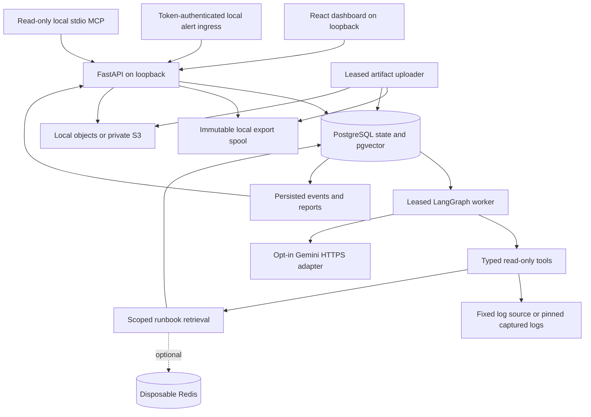
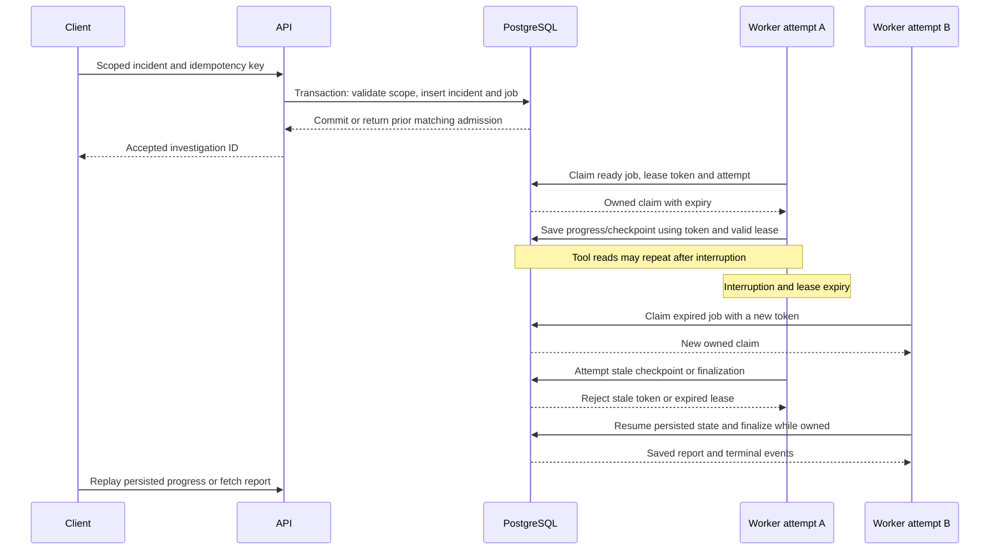
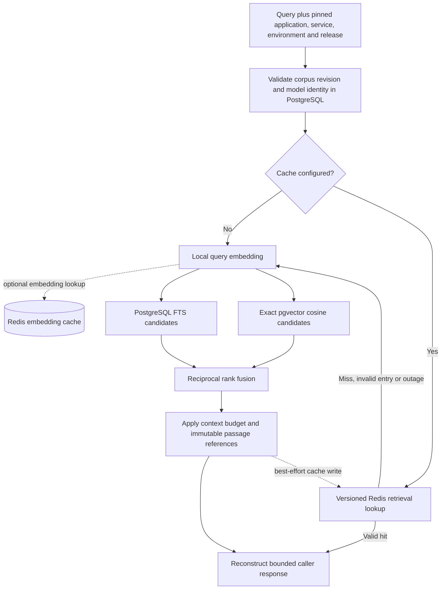
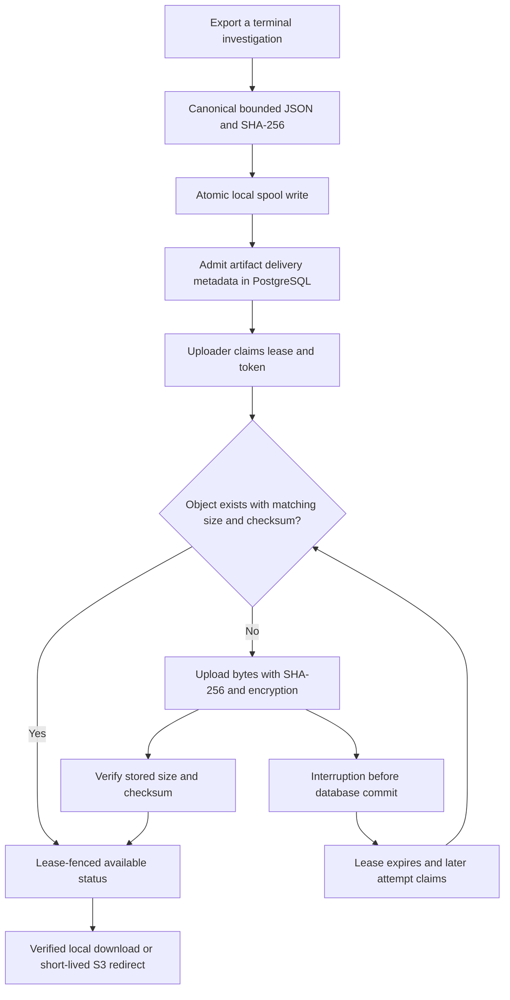

# Implemented architecture

This is the local release architecture. The app is unauthenticated and must remain bound to loopback. Metrics/traces backends, Kubernetes, automatic remediation, public hosting and tenant isolation are outside this diagram. S3 is optional real cloud storage; the application itself runs locally.

## Components

The API, worker and uploader are separate processes sharing application modules. PostgreSQL owns admission, registry/snapshot revisions, jobs, leases, checkpoints, reports, events and artifact metadata. Redis is never authoritative. Provider credentials are supplied only to the model worker; AWS credentials only to the S3 API/uploader. This is credential placement, not complete compromise isolation: runtime database credentials and network reachability remain shared trust boundaries. Evaluation labels are excluded from application images.

## Incident admission, lease and fencing

Admission and job insertion share one transaction; a reused key with different input is a conflict. Claims use database locking and token/expiry predicates on subsequent writes. This is at-least-once execution, not exactly-once execution. An unknown model-call outcome stops rather than repeating the external request. Saved call reservations/checkpoints make that ambiguity explicit. Cancellation invalidates ownership before further state transitions. LangGraph orchestration uses application-owned persisted state, not a native PostgreSQL LangGraph checkpointer.

## Retrieval and optional cache

FTS uses `plainto_tsquery` and `ts_rank_cd`, not BM25. Exact cosine search avoids approximate-index tuning for the current small corpus. Experimental query shaping, diversity and reranking remain explicit options; baseline ranking is retained. Cache keys include scope, revision, exact query and model/profile identity. Expiry, malformed data or Redis failure falls back to the database/encoder. Successful empty retrievals may be cached; unavailable retrievals are not successful empty results. Cache is optional and off by default. PostgreSQL validation still occurs on a cache hit.

## Export delivery and reconciliation

Object identity is deterministic per investigation, backend and content. Migration 0008 changed metadata uniqueness from object key alone to `(backend, object_key)`, allowing independent local and S3 copies. A later uploader can recognize an already successful object write. This reconciles two stores without asserting a distributed transaction. S3 downloads expire after 300 seconds; possession of the URL grants access during its validity. The unauthenticated local API is still a trusted local boundary. Checksum verification proves byte integrity, not privacy or semantic claim support.
