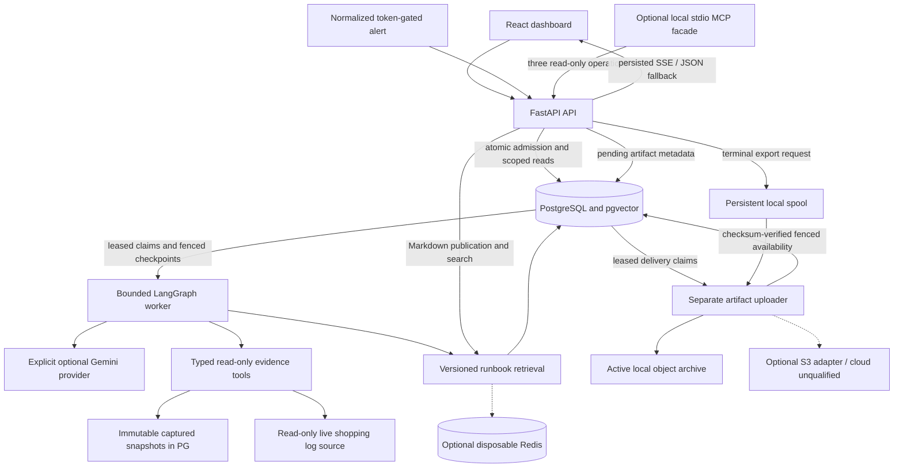

# Current local architecture

This diagram shows the implemented boundaries. S3 needs separate SDK/account qualification; a local archive is the active backend. Full Prometheus/Loki/Tempo and native Alertmanager are not hidden behind these boxes.

## Ownership

PostgreSQL owns application/configuration heads and immutable revisions, captured snapshots, incidents, jobs, investigation checkpoints, saved evidence, reports, events, knowledge revisions/passages and artifact availability. Redis owns nothing authoritative. Worker memory and LangGraph execution state can be lost; committed checkpoints/results govern recovery. The local artifact store is an export copy, not the job queue or the only copy of compact evidence.

Configuration heads use application/environment/release, while a knowledge head is a complete corpus per application containing applicability metadata. Incident admission pins a configuration/source. Agent follow-up retrieval pins its first successful knowledge revision/profile. This distinction explains the whole-application replacement warning on Markdown publication. Old citations/configurations/snapshots remain resolvable.

## Transaction boundaries

Incident, investigation, initial event and job admission commit together. A worker owns a bounded lease token; another worker may recover expiry, but stale owners cannot persist/finalize. External model requests are reserved before sending; unknown interrupted outcomes abstain instead of automatically repeating spending.

Embeddings are prepared before the publication transaction. The expected head is checked under an advisory lock, immutable rows publish completely and the active pointer changes atomically. Redis hits still require authoritative revision/model checks. Cache IO failures cannot change the source result.

Artifacts cross a database/filesystem/object boundary. Write the spool before admitting delivery, use stable checksum-based keys, verify existing remote/local bytes after a crash, and mark available only through the current lease. Orphan spool cleanup is deferred. Do not call this a distributed atomic commit or exactly-once upload.

## Permissions and failure meaning

The worker reaches the evidence network, not the fault controller or direct target networks. Evaluation labels/control settings remain outside its data. The model cannot choose arbitrary URLs, commands or database queries. MCP's read-only workspace facade does not enlarge the internal agent's dependency/window permissions.

Untrusted prose/logs remain data; reference IDs are structurally checked, not proof of semantic support. Failed sources are unavailable, successful empty results are distinct. Redis outage falls back. Artifact outage leaves diagnosis/report intact and delivery visibly pending/failed. Event transport failure falls back to saved JSON events.

See DECISIONS.md for alternatives/tradeoffs, STATUS.md for actual verified/deployed state and INTERVIEW_GUIDE.md for a concise explanation. The broader ARCHITECTURE.md remains the full roadmap.

## Native alert and measured-progress update

The API now accepts /api/webhooks/alertmanager as a separate bounded version-4 envelope, reusing the normalized endpoint's token and transactional incident admission. Full shape validation precedes independent per-alert commits; response items disclose partial acceptance/conflicts and duplicates reuse jobs. Explicit frozen evidence windows prevent delivery timestamps from silently moving scope. No Alertmanager server is installed. See ALERTS.md.

The target-only payment controller supports slow/handler-error injections in addition to unavailable/healthy; mode/TTL remain outside investigator evidence. Read-only logs expose correlated timestamps/durations/statuses and checkout's timeout 504. Operator captures and labels remain under evaluation, excluded from application builds. The Evaluation UI imports generated aggregate numbers/provenance only; it never submits model calls or exposes labels. The private S3 launcher and migration 0008 are qualified separately in S3_CONNECTION.md.
